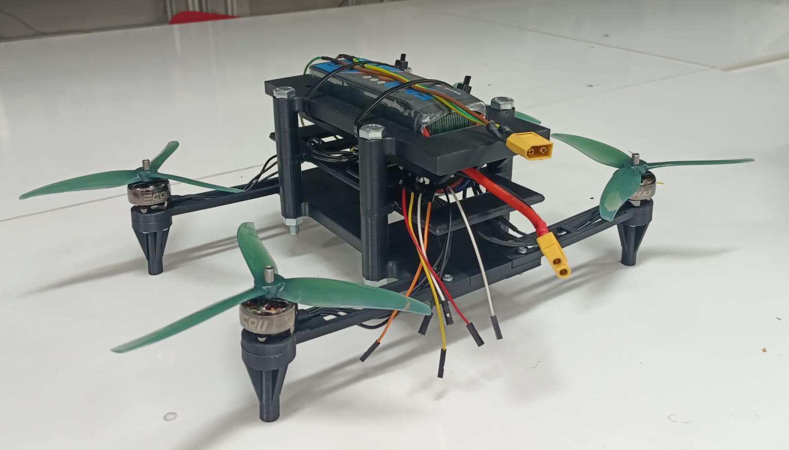
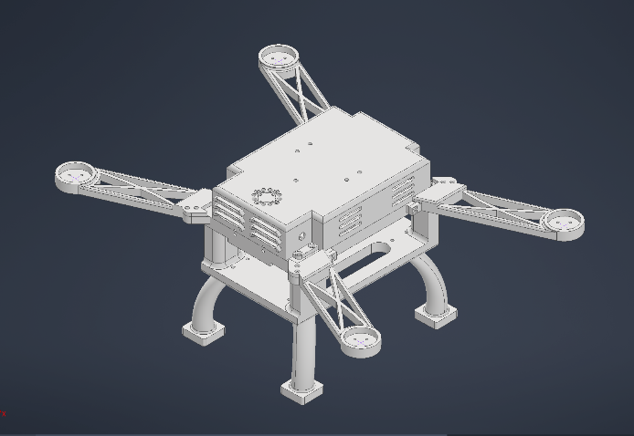
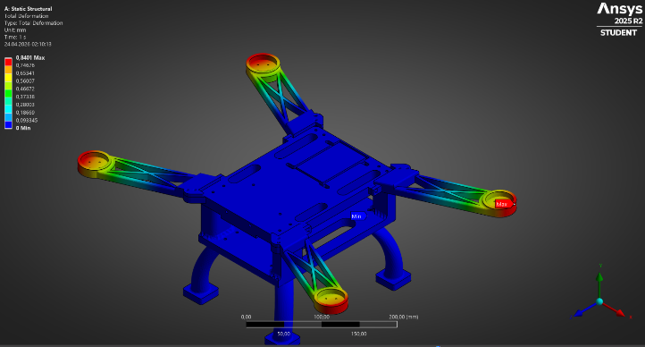

# Autonomous UAV Engineering Portfolio

**UAV system integration · Autonomy · Control design · Computer vision · Simulation**

A curated technical portfolio covering three separate UAV project tracks and a MATLAB-based multirotor control-design section. Projects are documented at the evidence level supported by their source reports; a design proposal, bench validation, simulated test, and flight test are not treated as equivalent.

| Project | Technical focus | Status supported by supplied materials |
|---|---|---|
| [ENG401 Autonomous Patrolling UAV](projects/01-eng401-autonomous-patrol/README.md) | Pixhawk/ArduCopter, Mission Planner, power/ESC integration, waypoint–servo mission | **Hardware assembly and bench tests**; full-power flight not completed in Jan 2026 report |
| [EFES-2026 İCAROS](projects/02-efes2026-icaros/README.md) | CAD/FEA, UAV power and avionics architecture, SITL, vision pipeline | **Design and reported prototype/testing**, with independent flight evidence not included |
| [TEKNOFEST UAV Work](projects/03-teknofest-uav/README.md) | AF-1 fixed-wing PX4/Gazebo SITL, mission planning, fire/smoke vision; later visual target R&D | **Previously described simulation/R&D**; flight logs and original project files pending |
| [MATLAB Multirotor Control Design](projects/04-matlab-multirotor-control/README.md) | 6-DOF model, cascaded control, attitude and position stabilization, controller analysis | **Design-method documentation**; a NEW teaching/reference MATLAB example is provided, not archival source |

## Selected visuals from original reports

### ENG401 — built multirotor

### EFES-2026 — CAD and structural analysis

## Core technical themes

- **System integration:** motors, 4-in-1 ESC, energy distribution, embedded avionics, telemetry, GNSS, servo actuator wiring.
- **Control and autonomy:** multirotor dynamic modeling, cascaded controllers, navigation planning, hardware-in-the-loop and software-in-the-loop concepts.
- **Vision:** object-detection pipeline integration and camera-based mission sensing; see the separate YOLO portfolio for model training artifacts.
- **Verification:** distinguish propeller-off bench validation, simulations, component analysis, and independently logged flight tests.

## Source and collaboration

The ENG401 report (January 2026) is a collaborative university engineering project supervised by **Asst. Prof. Dr. Meryem Deniz** and **Asst. Prof. Dr. Çağdaş Karataş**. The EFES-2026 report describes the **İCAROS** team project. Images selected from the reports remain attributable to the respective teams. Do not present team work as sole authorship. Source reports are held outside the public-ready repository folder due to collaborator contact data.

## Read next

- [Technical comparison](docs/project-comparison.md)
- [Verification evidence and limitations](docs/verification-status.md)
- [Source/asset register](ASSET_REGISTER.md)
- [How to add demonstration videos](docs/media-and-video-guide.md)

**Publication status:** documentation and selected original report figures included; not a fully reproducible flight-software release.
