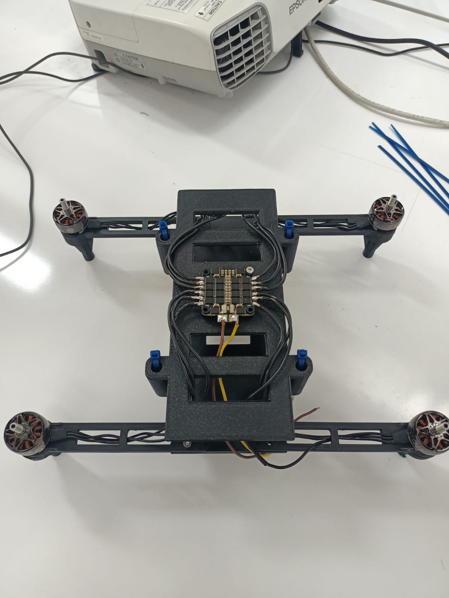
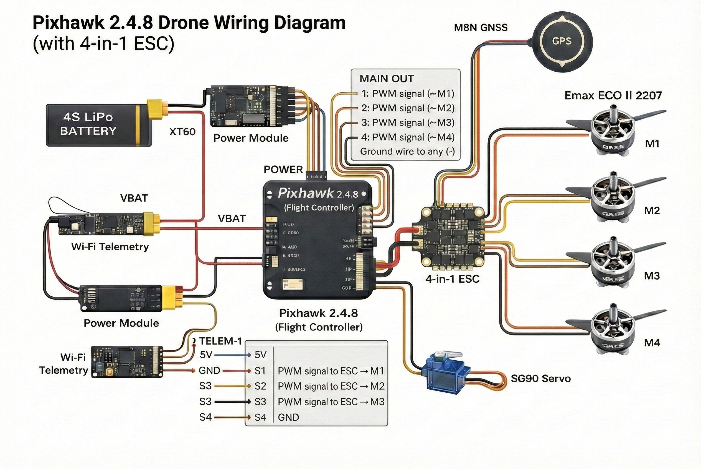
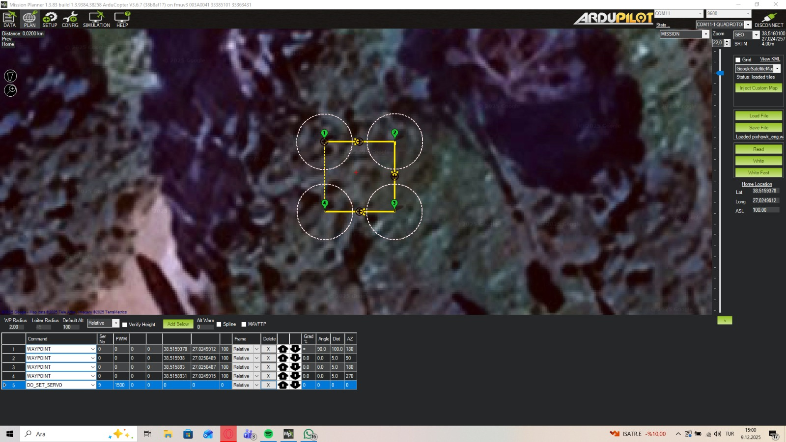
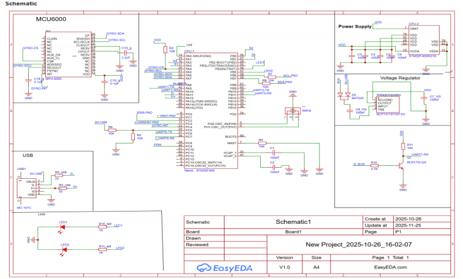
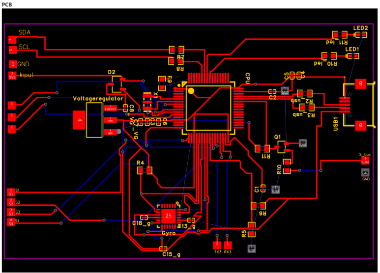

# ENG401 — Autonomous Patrolling Quadcopter

**University interdisciplinary project · January 2026 · İzmir Kâtip Çelebi University**

## Objective

Integrate a quadcopter designed for waypoint-based patrolling and mission-synchronized auxiliary servo actuation using a proven Pixhawk/ArduCopter autopilot stack. The project includes mass/thrust planning, wiring, firmware configuration, electrical safety checks, and bench validation.

## Hardware configuration documented in the report

| Subsystem | Reported configuration |
|---|---|
| Airframe | 350 mm H-frame quadcopter |
| Autopilot | Pixhawk 2.4.8, ArduCopter |
| Ground station | Mission Planner |
| Motors | 4 × EMAX ECO II 2207, 1700 KV |
| ESC | 4-in-1 ESC, 60 A class |
| Propellers | 6-inch, three-blade |
| Battery | 4S 5200 mAh LiPo (planned/specified) |
| Navigation | M8N GNSS and integrated compass |
| Telemetry | Wi-Fi MAVLink 2 |
| Mission actuator | SG90 servo; `DO_SET_SERVO` via AUX output |
| All-up weight | Approximately 1.06 kg, component-based estimate |

## System integration

The report documents 4-in-1 ESC soldering, battery-power distribution, flight-controller signaling, GNSS/compass, telemetry, servo output wiring and insulation/continuity checks. Propellers were removed for initial motor testing.

## Mission Planner workflow

A proposed patrol mission uses GPS waypoints and can insert `DO_SET_SERVO` events after selected waypoints or at route completion. The documented test program includes orientation and sensor calibration, motor output-to-motor checks, ESC mapping, and servo actuation.

## Results and technical boundaries

**Completed/documented:** platform assembly, firmware upload/configuration, ground-station connection, sensor checks, propeller-off motor output mapping, and auxiliary servo command checks.

**Not completed in the January 2026 report:** full-power flight testing due to temporary flight-battery unavailability. Therefore waypoint-tracking error, endurance, actual flight stability, and airborne servo command execution were **not established**.

## PCB concept

The team produced an **EasyEDA schematic/layout concept** of a flight controller. The report explicitly states that the concept was **not fabricated**.

## Further documentation

- [Hardware integration](docs/hardware.md)
- [Test record](docs/results-and-limitations.md)
- [Report image evidence](../../assets/eng401/)

**Credits:** ENG401 interdisciplinary project team, supervised by Meryem Deniz and Çağdaş Karataş; Mustafa Deri is a listed team member. Original January 2026 team report.
