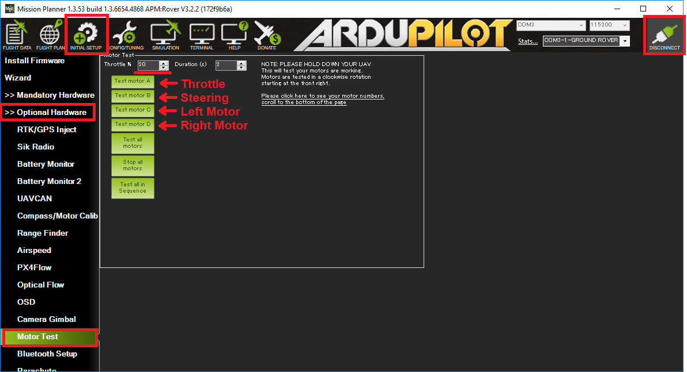

# ENG401 — Results and Limitations

## Evidence-backed achievements

The January 2026 final report records successful Pixhawk firmware setup, Mission Planner connection and calibration workflow, propeller-off motor-output tests, ESC interfacing, and servo command checks. This substantiates **bench-level subsystem integration**, not validated autonomous flight.

## Flight test status

The report states that full-power flight testing could not be completed because of temporary flight-battery unavailability. Accordingly there are **no reported measured results** for flight endurance, thrust, GPS waypoint-tracking error, lateral position stability, or payload interaction in flight.

## Future work

Add flight logs, motor-current and battery traces, post-flight safety and reliability review, waypoint tracking data and camera-based patrol results. Any later flight testing should be documented separately with a date, platform configuration and reproducible logs.
