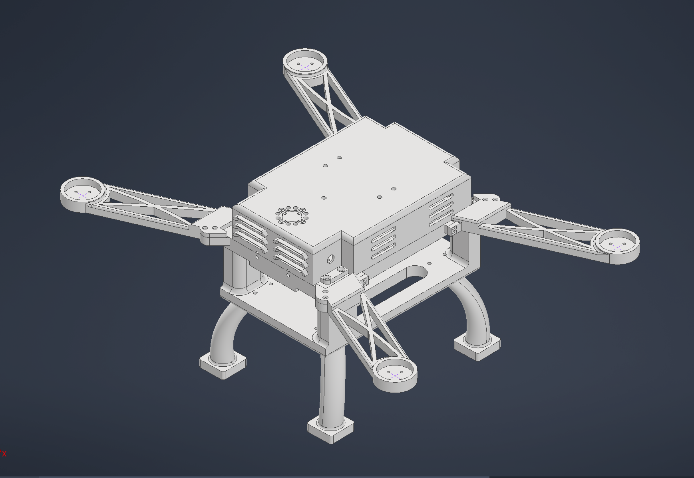
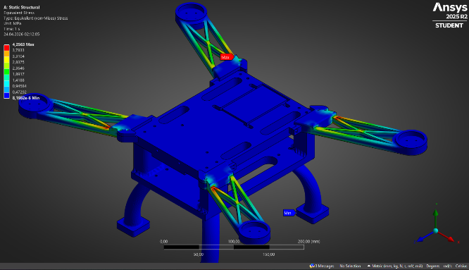
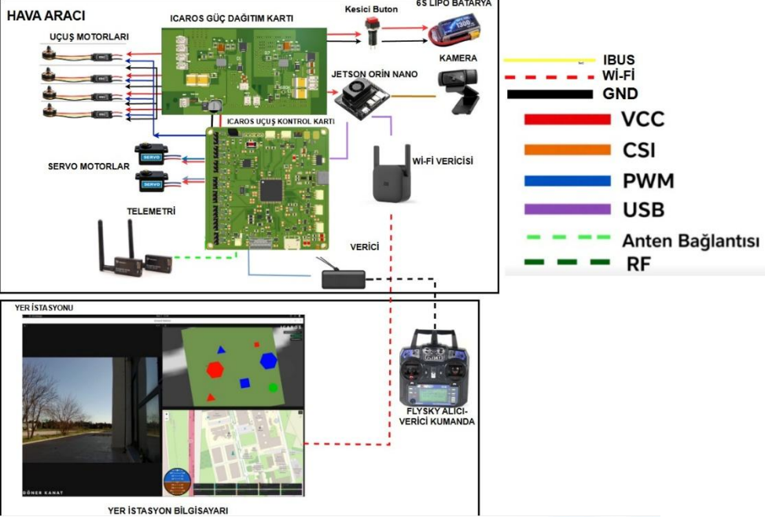
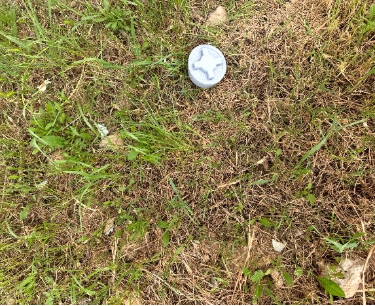
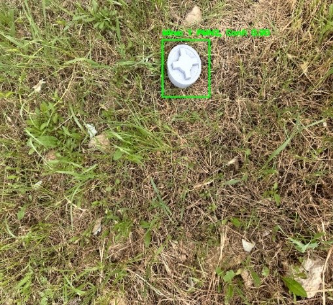

# EFES-2026 İCAROS — UAV Design, Autonomy and Vision

**Team engineering project · EFES-2026 technical report**

The İCAROS project proposes an autonomous aerial survey platform combining lightweight additive-manufactured structure, flight control and power distribution electronics, mission planning, onboard computer vision, and a ground-control interface. Its image-recognition component is described for **inert 3D-printed mine-shaped mockups**; images alone do not establish detection of real explosive devices.

## Mechanical design and simulation

The report describes Autodesk Inventor CAD work, a proposed PA612-CF composite structure, and Ansys static/deformation analysis.

| Quantity | Reported figure | Interpretation |
|---|---:|---|
| Frame mass | 590 g | Structure/design figure; **not total takeoff mass** |
| Max simulated deformation | 0.84 mm | FEA estimate for modeled load case |
| Max von Mises stress | 63.782 MPa | FEA estimate, not material test |
| Safety factor | 1.14 | Relatively limited margin; requires careful load-case validation |
| Structural print settings | 5% gyroid, six walls | Source report specifies these parameters |

## Electronics and mission architecture

The project report describes an STM32H743VIT6-based custom flight-control concept with BMI270 IMU, six-cell LiPo distribution and a companion computer (Jetson Orin Nano). It also includes a **Pixhawk 6C** in the costed component list. These should be treated as distinct design/procurement configurations until the actual deployed board is documented.

## Computer vision and simulation

The submitted report describes a grid/lawnmower survey, YOLO-based detection of M14/PFM1/PMN2-shaped inert mockups, a ground-intersection geolocation concept, a ground station, and ArduCopter Gazebo Harmonic SITL tests. The report states that field validation was achieved, but original logs/video evidence were not supplied with these files; treat field-readiness and accuracy claims as **reported by the team, not independently verified**.

## Engineering cautions

- Predicted ~660 W / 28 A operating point, 3.28 thrust-to-weight ratio, and ~8.5-minute endurance are **report figures**, not flight-log measurements.
- A claimed high technology-readiness level is not independently substantiated by these source attachments; flight and detection logs would be needed.
- "Zero latency" and perfect stabilization are not physically meaningful performance guarantees.
- A render/photo of a generic PCB does not prove an original flight-control board was manufactured or validated.
- Ray-to-ground projection precision depends on camera calibration, pose accuracy and terrain; geolocation error was not quantified in supplied material.

## More detail

- [System architecture and electronics](docs/architecture.md)
- [CAD, analysis and validation](docs/results-and-limitations.md)
- [Cross-project vision links](../../docs/media-and-video-guide.md)

**Attribution:** EFES-2026 İCAROS team; contributor Mustafa Deri is listed in the original team report.
