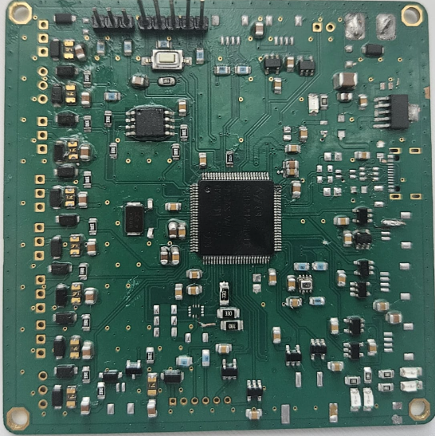
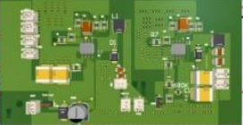

# EFES-2026 — Proposed Architecture

## Mechanical design

The supplied technical report describes composite 3D-printed quadcopter frame fabrication (PA612-CF), CAD in Inventor, and static analysis in Ansys. The cited frame mass and structural safety factor are modeled/design values.

## Power and avionics concepts

- 6S LiPo battery; custom power-distribution board (PDB) concept and protection elements.
- STM32H743VIT6 custom flight-controller concept, BMI270 IMU, SPI/I2C/UART sensor interfaces.
- Separate Pixhawk 6C listing in the project budget. This is an architectural/procurement inconsistency that requires configuration confirmation.
- Jetson Orin Nano companion computer for proposed vision tasks and ground-station interface.

## Autonomy software flow

`Mission area → grid/lawnmower waypoint plan → UAV imaging → inert mockup detection → estimated target map point → operator visualization`

The report mentions Gazebo Harmonic, ArduCopter SITL, ray–ground intersection and a PyQt6 ground station. Software repositories, calibration files, flight logs, and geolocation error analyses are not included.

## Safety and scope

This is a technical portfolio entry describing inert-mockup visual recognition and conceptual survey systems. Do not infer explosive-device recognition capability, validated hazard clearance, or deployment suitability from images of printed objects.
