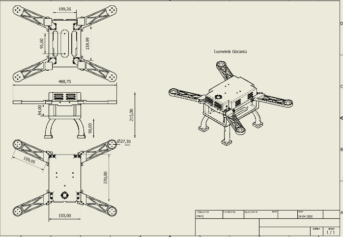
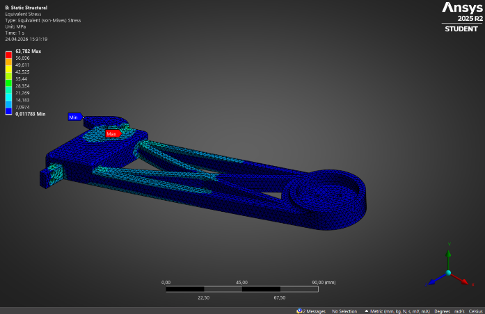

# EFES-2026 — Design Outputs, Reported Tests, Limitations

## Design outputs captured in the report

- Frame CAD and technical dimensions (Inventor).
- Structural and arm analyses (Ansys); report gives 0.84 mm deformation, 63.782 MPa maximum von Mises stress and safety factor 1.14.
- Block architecture of UAV avionics, power and mission computing.
- Illustrative custom FC/PDB pictures.
- Before/after detection image of an inert mine-shaped test object.

## Reported but not independently validated here

The EFES report claims Gazebo/ArduCopter simulation, field validation and high technology readiness, but this ZIP does not contain SITL logs, UAV flight logs, geolocation benchmark datasets, controller firmware, physical PCB manufacturing files, or evaluation videos. These claims remain attributed to the report.

## Engineering issues to resolve before stronger publication claims

1. **Flight controller:** custom STM32H743 vs budgeted Pixhawk 6C — distinguish prototype variants.
2. **Weight:** the 590 g frame figure is not the system's fully equipped takeoff weight.
3. **Power and endurance:** report estimates need thrust-stand and flight-log evidence.
4. **FEA:** clarify printing anisotropy, material conditions, load combinations, factor of safety and mesh sensitivity.
5. **Vision:** M14/PFM1/PMN2 categories refer to mockup image classes only; provide held-out validation and adverse-condition tests.
6. **Geolocation:** publish camera calibration, altitude/attitude uncertainty, coordinate reference, and mapping error if available.
